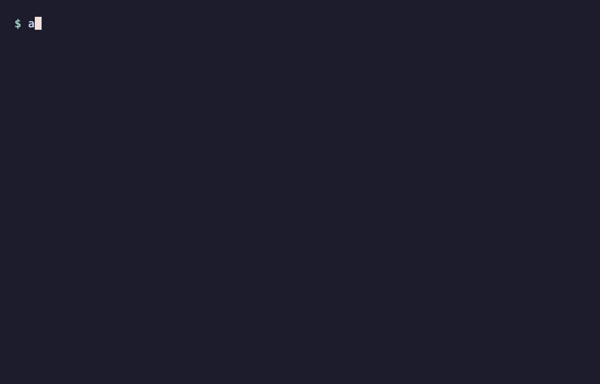

<h1 align="center">🕹️ agent-arcade</h1>

<p align="center">
  <b>Play small games in your terminal while your AI coding agent works.</b><br>
  When it finishes (or needs your approval), the game pauses, beeps and tells you.
</p>

<p align="center">
  <a href="https://www.npmjs.com/package/agent-arcade"></a>
  
  
  <a href="LICENSE"></a>
</p>

<p align="center">
  
</p>

Claude Code and Codex can take minutes on a task. Instead of staring at a spinner or wandering off to another tab and forgetting to come back, play a quick round right there, and get pulled back the moment your agent is done.

- **Knows when your AI is done.** A yellow banner for "finished", a red one for "needs your input", plus a beep.
- **Never costs you a game.** It pauses on the banner, and whenever you click away.
- **Opens beside your agent.** A popup or split next to Claude Code, with one command.
- **Works with Claude Code and Codex**, and any other agent that can run a command.
- **Tiny and private.** No dependencies, no account, no tracking. Your scores stay on your computer.

## Getting started

### Claude Code: install the plugin (easiest)

At the Claude Code prompt:

```
/plugin install agent-arcade --marketplace Kuldeep-045/agent-arcade
```

Answer `y` to add the marketplace and press Enter to pick a scope. That's it: no npm install and no `setup`.

- `/arcade` opens the arcade **instantly**, even while Claude is in the middle of a task.
- When Claude finishes, or stops to ask you something, your game pauses and a banner tells you.

From a shell instead: `claude plugin install agent-arcade --marketplace Kuldeep-045/agent-arcade`. The plugin uses `agent-arcade` if it's installed, and `npx` if it isn't. If you already ran `agent-arcade setup` for Claude Code, you can run `agent-arcade setup --uninstall` and keep only the plugin, or keep both.

### Any agent: install from npm

**1. Install**

```sh
npm install -g agent-arcade
```

**2. Connect your agents** (once)

```sh
agent-arcade setup
```

This connects whatever you have installed:

| Agent | What `setup` adds |
|---|---|
| Claude Code | a hook for "finished", a hook for "waiting for you", and an `/arcade` command |
| Codex | a `notify` line in `~/.codex/config.toml` |

It backs up each file first, keeps any hooks you already have, and `agent-arcade setup --uninstall` removes everything it added.

**3. Play**

Start a task in your agent, then open the arcade:

| Where you are | How to open it |
|---|---|
| Inside Claude Code | type `/arcade` |
| Any terminal tab | run `agent-arcade` |
| Straight into a game | run `agent-arcade snake` |

When the banner pops up, press **q** to get back to work, or **c** to keep playing.

> Restart Claude Code or Codex after `setup`. Sessions that were already open don't pick up the new hooks.

## Controls

| Key | Does |
|---|---|
| ↑ ↓ ← → or W A S D | move |
| Esc | pause; then **r** restart · **m** menu · **q** quit |
| q / c | on the AI banner: back to work / keep playing |

The game also pauses by itself when you click away from it. Every start, restart and resume gives you a **3-2-1 countdown**, so you're never caught off guard.

## Where it opens

`/arcade` (and `agent-arcade popup`) opens the arcade next to your agent, using what your terminal supports:

| Terminal | Opens as |
|---|---|
| tmux | a popup in the middle of the window |
| Ghostty | a split beside the chat, or a centered popup (see below) |
| iTerm2 | a split beside the chat |
| macOS Terminal | a new window |
| Anything else | run `agent-arcade` in a new tab |

**Ghostty popup tip:** add these lines to your Ghostty config and the arcade floats in the middle of the screen, with a shortcut that works even while your agent is busy:

```
quick-terminal-position = center
quick-terminal-size = 60%,55%
keybind = super+shift+s=toggle_quick_terminal
```

## Other agents

Any agent (or script) that can run a command when it finishes can use the banner:

```sh
agent-arcade notify        # yellow: "Your AI is done!"
agent-arcade notify ask    # red: "Your AI needs your input!"
```

## Games

| Game | |
|---|---|
| 🐍 **Snake** | Eat, grow, don't hit the walls or yourself. Speeds up as you score. |

More are on the way.

### Add a game

Each game is one small file in [`src/games/`](src/games). The shell gives it the menu, the AI banners, pausing and best scores for free; the game only keeps its own state and draws its board. The interface is documented at the top of [`src/games/index.mjs`](src/games/index.mjs), and [`snake.mjs`](src/games/snake.mjs) is a complete example in about 60 lines. Pull requests are welcome!

## Sponsor line

agent-arcade is free. To help keep it that way, the menu and the game-over screen may show one line of text from a sponsor:

```
Sponsored · Acme Cloud: deploy in one command → acme.dev
```

- It never shows while you're playing, and it's always labelled "Sponsored".
- About once a day, the game downloads one small public file, [`sponsor.json`](sponsor.json) in this repo, to get it. The request sends nothing about you: no ID, no scores, no tracking. Like any download, GitHub sees a normal web request.
- **Turn it off** with `agent-arcade ads off` (or set `AGENT_ARCADE_ADS=off`). Then nothing is downloaded at all. `agent-arcade ads on` brings it back.

Interested in sponsoring? [Open an issue](https://github.com/Kuldeep-045/agent-arcade/issues).

## How it works

```
Claude Code / Codex ──finishes──▶ agent-arcade notify ──▶ ~/.agent-arcade/signal
                                                                 │
                       the game checks it a few times a second ◀─┘ → pause, beep, banner
```

Best scores live in `~/.agent-arcade/best.json`. That folder is all agent-arcade keeps; scores and play never leave your computer.

## Uninstall

```sh
agent-arcade setup --uninstall   # remove the hooks and /arcade
npm uninstall -g agent-arcade
rm -rf ~/.agent-arcade           # optional: your best scores
```

## License

[MIT](LICENSE)
